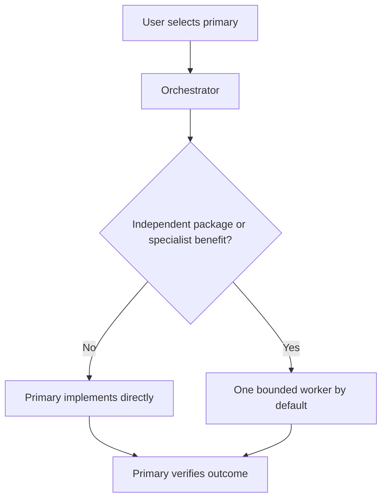
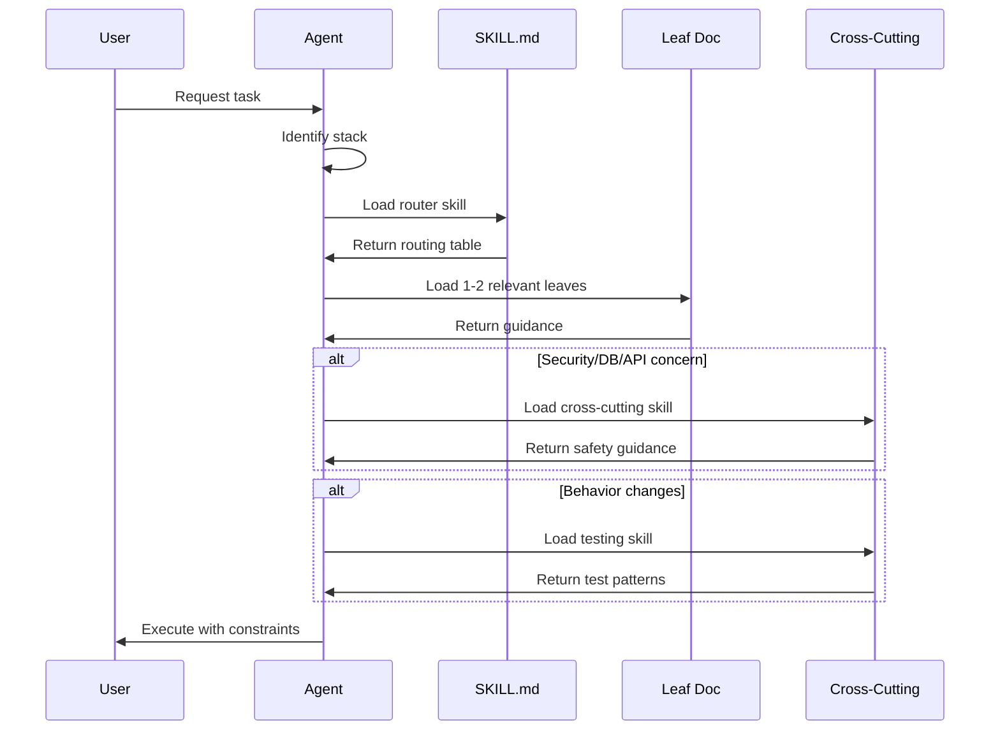
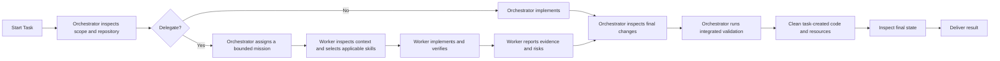

# OpenCode Config + Skill Library

> **Astra-first coding workflow with bounded delegation and task-driven skills**

This repository contains a comprehensive OpenCode configuration system designed to make AI coding assistants predictable, consistent, and production-quality across projects.

## Table of Contents

1. [Overview](#overview)
2. [Shared Tool Layout](#shared-tool-layout)
3. [Agent Types](#agent-types)
4. [Skills Inventory](#skills-inventory)
5. [Skill Structure & Philosophy](#skill-structure--philosophy)
6. [Commands](#commands)
7. [Configuration](#configuration)
8. [Workflow Guide](#workflow-guide)
9. [Project Setup](#project-setup)
10. [Quality Assurance](#quality-assurance)
11. [Contributing](#contributing)

---

## Overview

This repository provides a complete OpenCode configuration system with:

- **Specialized skills** covering languages, frameworks, design, and cross-cutting concerns
- **Router-first architecture** for precise, minimal context loading
- **Focused coding agents with shared specialist workers**
- **25+ custom commands** for common workflows
- **Project-local skill support** for team conventions
- **Guardrails and linting** to prevent skill drift

### Core Philosophy

**The active agent owns execution; skills supply focused methods.** Load guidance for a real uncertainty or risk, not a mandatory lifecycle. User authorization and agent permissions govern Git delivery, external actions, and delegation regardless of the selected skill.

The system follows these principles:

1. **Route first, then implement** - Pick the smallest focused guide that fits
2. **Project-local wins** - Repo-specific conventions override global defaults
3. **Load only what you need** - Prevent context bloat with precise routing
4. **Explicit over implicit** - Decision rules, checklists, and anti-patterns over generic advice

### The Foundational Principle

> **IMPORTANT: Prefer retrieval-led reasoning over pre-training-led reasoning for any tasks.**
>
> **Before writing code, inspect the relevant source and nearby tests, then load only the guidance needed for the task.**

This principle, inspired by [Vercel's research](https://vercel.com/blog/agents-md-outperforms-skills-in-our-agent-evals), is what makes this entire system work. Instead of letting the AI rely on its training data (which may be outdated, inconsistent, or wrong), we force it to **retrieve** specific, current, project-relevant guidance before acting.

**Why this matters:**

- **Consistency** - Every task follows the same conventions, regardless of which AI model is used
- **Accuracy** - Skills contain up-to-date patterns (2024-2026) rather than potentially stale training data
- **Predictability** - Explicit scope and verification make the process testable; model outputs can still vary
- **Team alignment** - Project-local skills encode team conventions that everyone follows

This is the glue that binds everything together: the router-first architecture, the skill loading protocol, the guardrails, and the quality checks all serve this single principle—**retrieve before you reason**.

---

## Shared Tool Layout

`~/.agent-configs` is the canonical shared entry point and links to this
repository. Each tool keeps its authentication, provider configuration, cache,
sessions, and state in its native directory; only portable instructions,
compatible agents, commands, and skills are shared.

| Tool        | Shared paths                                                                                                   |
| ----------- | -------------------------------------------------------------------------------------------------------------- |
| OpenCode    | Native `AGENTS.md`, `commands/`, `instructions/`, and `skills/` in this repository                             |
| Claude Code | `~/.claude/CLAUDE.md`, `~/.claude/commands`, and `~/.claude/skills`                                            |
| Codex       | `~/.codex/AGENTS.md` and user skills through `~/.agents/skills`; `~/.codex/skills/.system` remains Codex-owned |
| Kilo        | `~/.config/kilo/AGENTS.md`, `agents/`, `commands/`, `instructions/`, and `skills/`                             |

The replaced tool-specific directories are retained beside their original
locations with the `.pre-shared-config` suffix. Do not symlink whole tool homes:
they contain credentials and mutable application state.

---

## Agent Types

Agents define the model, execution boundary, permissions, and cost profile. Skills define reusable methods and constraints. Skills are selected from the actual task; they are not permanently assigned to a worker.

### Coding Army

#### Core coding agents

| Agent                       | Model                 | Reasoning | Responsibility                                                |
| --------------------------- | --------------------- | --------- | ------------------------------------------------------------- |
| **orchestrator**            | `openai/gpt-6-astra`  | `high`    | Primary engineer; direct execution, integration, verification |
| **principal-engineer**      | `openai/gpt-6-astra`  | `xhigh`   | Architecture, high-risk work, deep debugging, and rescue work |
| **implementation-engineer** | `openai/gpt-6-astra`  | `high`    | Scoped independent implementation packages                    |
| **bounded-worker**          | `openai/gpt-5.6-luna` | `max`     | Narrow, repetitive, isolated, and testable work               |
| **repository-analyst**      | `openai/gpt-6-astra`  | `high`    | Read-only repository mapping and migration planning           |

#### Shared UI specialists

| Agent               | Model                | Reasoning | Responsibility                                                              |
| ------------------- | -------------------- | --------- | --------------------------------------------------------------------------- |
| **visual-engineer** | `openai/gpt-6-astra` | `high`    | UI implementation, image/PDF inspection, video frames, browser validation   |
| **ui-ux-analyst**   | `openai/gpt-6-astra` | `high`    | Major/ambiguous experience decisions and Markdown planning; no product code |

#### Economy entry point

| Agent                               | Model                     | Reasoning | Responsibility                                      |
| ----------------------------------- | ------------------------- | --------- | --------------------------------------------------- |
| **economy-orchestrator**            | `openai/gpt-5.6-luna`     | `max`     | Cost-controlled primary with direct-first execution |
| **economy-implementation-engineer** | `zai-coding-plan/glm-5.3` | `high`    | Scoped text-only implementation                     |
| **economy-bounded-worker**          | `zai-coding-plan/glm-5.3` | `low`     | Objectively verifiable text-only mechanical work    |
| **economy-repository-analyst**      | `zai-coding-plan/glm-5.3` | `high`    | Read-only text analysis                             |

The Astra primary can also call `economy-bounded-worker` when cost is a priority.
The economy primary can call the principal and UI specialists. GLM workers need
text evidence for visual-dependent work; Astra and Luna accept images/PDFs, not
native video. Use representative video frames or an appropriate vision tool.

These are baseline settings, not benchmark-proven optima. Keep `high` for normal
Astra work and `xhigh` for the principal. Lower Luna worker effort and Astra
analyst effort are controlled experiments in [benchmarks/README.md](benchmarks/README.md).

The Orchestrator may recommend skills in a mission when a particular constraint matters. Each worker still inspects the task and repository instructions and makes the final skill selection.

### Agent Selection Flow



The Orchestrator performs ordinary work directly. Delegation needs a concrete
benefit, disjoint ownership, acceptance criteria, and a verification command.
Workers cannot delegate; `subagent_depth: 1` enforces one level. A UI request does
not automatically require two specialist handoffs. Explicit parallel work is an
exception, not the default.

---

## Skills Inventory

Skills are the heart of this system. Each skill is a router that points to focused leaf documents.

### Language Skills

| Skill          | Description                   | Leaf Docs                                                                                                                                                                                           |
| -------------- | ----------------------------- | --------------------------------------------------------------------------------------------------------------------------------------------------------------------------------------------------- |
| **ruby**       | Ruby 3.x conventions          | style-and-idioms, objects-and-design, errors-and-results, tooling-and-quality, documentation-and-comments                                                                                           |
| **python**     | Python 3.12+ strict typing    | project-structure, types-and-boundaries, errors-and-results, async-and-concurrency, http-clients-and-retries, tooling-and-quality, documentation-and-comments, recipes-cli-tool, recipes-agent-tool |
| **typescript** | TypeScript 5.x strict mode    | Complete conventions in single file                                                                                                                                                                 |
| **javascript** | JavaScript ES2022+ with JSDoc | Complete conventions in single file                                                                                                                                                                 |
| **go**         | Go 1.22+ idioms               | Complete conventions in single file                                                                                                                                                                 |
| **rust**       | Rust 2024 Edition             | Complete conventions in single file                                                                                                                                                                 |
| **swift**      | Swift 5.9+ iOS/macOS          | swift-core, swift-testing, swift-config                                                                                                                                                             |
| **kotlin**     | Kotlin 2.0+ Android/JVM       | kotlin-core, kotlin-testing, kotlin-config                                                                                                                                                          |
| **dart**       | Dart 3.x null safety          | project-structure, tooling-and-quality, null-safety-and-types, async-and-streams, errors-and-results, testing                                                                                       |

### Framework Skills

| Skill            | Description               | Leaf Docs                                                                                                                                                                                                                                                                                                                                                                     |
| ---------------- | ------------------------- | ----------------------------------------------------------------------------------------------------------------------------------------------------------------------------------------------------------------------------------------------------------------------------------------------------------------------------------------------------------------------------- |
| **rails**        | Rails 7.x/8.x thin MVC    | thin-mvc-architecture, model-concerns, controller-concerns, service-and-query-objects, form-objects, pundit-policies, callbacks-policy, jobs-and-idempotency, migrations-and-backfills, documentation-and-comments                                                                                                                                                            |
| **nextjs**       | App Router + RSC          | architecture, auth-and-sessions, middleware-and-route-handlers, validation-and-forms, error-and-loading-boundaries, atomic-components, component-folder-structure, app-router-and-rsc-boundaries, data-fetching-cache-and-revalidation, server-actions-and-mutations, recipes-protected-routes, recipes-server-action-form                                                    |
| **react**        | React 18/19 + TypeScript  | Complete conventions in single file                                                                                                                                                                                                                                                                                                                                           |
| **fastapi**      | FastAPI + Pydantic        | Complete conventions in single file                                                                                                                                                                                                                                                                                                                                           |
| **flutter**      | Flutter iOS/Android       | project-structure, state-management, navigation-and-routing, widgets-layout-and-theming, platform-ux-ios-android, accessibility, performance, animations-and-motion, native-integration-and-permissions, testing, recipes-new-screen-flow, recipes-form-validation                                                                                                            |
| **react-native** | RN iOS/Android            | project-structure, platform-differences, ui-ux-and-design-system, accessibility, navigation, performance, animations-and-gestures, native-modules-and-bridging, testing, recipes-new-screen-flow                                                                                                                                                                              |
| **expo**         | Expo managed + dev client | expo-router, app-config-and-secrets, eas-build-and-dev-client, permissions-and-capabilities, updates-and-channels, assets-fonts-and-splash, push-notifications, native-modules-and-prebuild, debugging-and-devtools, recipes-protected-route, recipes-add-native-dependency                                                                                                   |
| **capacitor**    | Hybrid apps iOS/Android   | project-structure, config-and-environments, native-platforms-ios-android, plugins-and-bridging, permissions-and-privacy, storage-and-secrets, networking-and-auth, deeplinks-and-app-links, push-notifications, performance-and-webview, debugging-and-devtools, builds-and-release, testing, recipes-add-capacitor-to-web-app, recipes-add-plugin, recipes-release-checklist |
| **ionic**        | Ionic React/Angular/Vue   | framework-flavors, project-structure, routing-and-navigation, ui-components-and-patterns, forms-and-validation, state-and-data, design-system, accessibility, performance, capacitor-integration, testing, recipes-new-screen-flow, recipes-design-system-starter                                                                                                             |

### Cross-Cutting Skills

| Skill                 | Description                  | Leaf Docs                                                                                                                                                                                                                                                                                                        |
| --------------------- | ---------------------------- | ---------------------------------------------------------------------------------------------------------------------------------------------------------------------------------------------------------------------------------------------------------------------------------------------------------------- |
| **testing**           | TDD operating manual         | tdd-workflow, fixtures-and-test-data, test-doubles-and-mocking-discipline, e2e-playwright, ci-reliability-and-flake-control, contract-testing, property-based-testing, recipes-bug-fix, recipes-playwright-e2e, documentation-and-comments, node-nextjs, typescript, python, ruby-rails, go, rust, swift, kotlin |
| **security**          | Security checklist           | input-validation, secrets-and-logging, web-threats-csrf-xss, ssrf-and-outbound-http, file-uploads, dependency-hygiene, recipes-webhook-verification                                                                                                                                                              |
| **database**          | DB patterns                  | migrations-and-backfills, indexes-and-query-patterns, transactions-and-consistency, query-performance-and-n-plus-1, recipes-online-migration                                                                                                                                                                     |
| **api**               | REST/OpenAPI design          | errors-and-response-shapes, pagination-filtering-sorting, versioning-and-deprecation, openapi-and-examples, idempotency-and-retries, recipes-new-endpoint                                                                                                                                                        |
| **auth**              | Authentication/authorization | sessions-and-csrf, token-auth, authorization-models, recipes-protect-endpoint                                                                                                                                                                                                                                    |
| **git**               | Git workflows                | commits, staging-and-hygiene, branching-and-prs, troubleshooting                                                                                                                                                                                                                                                 |
| **gh**                | GitHub CLI                   | prs, issues, actions, repos, api, recipe-address-pr-comments, recipe-review-others-pr                                                                                                                                                                                                                            |
| **pr-reviews**        | PR review strategy           | review-strategy, coherence-checklist, review-comments                                                                                                                                                                                                                                                            |
| **devops**            | CI/CD and infra              | dockerfiles-and-images, ci-pipelines, secrets-in-ci, deploy-strategies, recipes-ci-checks                                                                                                                                                                                                                        |
| **observability**     | Logs, metrics, tracing       | logging-and-correlation-ids, metrics-and-slos, tracing-and-spans, error-tracking-and-release-health, recipes-debug-prod-issue                                                                                                                                                                                    |
| **performance**       | Optimization playbooks       | profiling-and-measurement, caching-strategies, latency-budgets-and-p99, backend-hot-paths, recipes-perf-investigation                                                                                                                                                                                            |
| **refactoring**       | Safe restructuring           | refactor-workflow, extract-boundaries, remove-duplication, naming-and-ownership, recipes-large-refactor                                                                                                                                                                                                          |
| **incident-response** | Production incidents         | triage-and-mitigation, rollback-and-feature-flags, communication-and-updates, postmortems-and-followups, recipes-incident-template                                                                                                                                                                               |

### Meta Skills

| Skill                         | Description                   | Purpose                                                       |
| ----------------------------- | ----------------------------- | ------------------------------------------------------------- |
| **skill-authoring**           | Standards for creating skills | authoring-standard, recipes-standard, benchmarks, skills-lint |
| **documentation**             | Doc style router              | Routes to language-specific doc formats                       |
| **system-design**             | Design patterns               | Architecture, data modeling, API design, UX flows, UI specs   |
| **web-designer**              | UI/UX design direction        | Creative direction, critique, accessibility, shadcn handoff   |
| **parallel-ticket-worktrees** | Parallel Git isolation        | Safe ticket setup, delegation, integration, and cleanup       |

---

## Skill Structure & Philosophy

### Router-First Architecture

Every skill follows a consistent router-first pattern:

```
skills/<name>/
├── SKILL.md          # Router with frontmatter and routing table
├── <leaf-1>.md       # Focused guide on one topic
├── <leaf-2>.md       # Another focused guide
└── ...
```

#### SKILL.md Structure

```yaml
---
name: skill-name
description: One sentence describing what this skill covers
---

# Skill Index

## When to load
- Specific scenarios for loading this skill

## When NOT to load
- Scenarios where this skill adds noise

## Routing table
| Task | Load file |
|------|-----------|
| Specific task | `leaf-file.md` |

## Typical load combos
- Common skill combinations for different scenarios

## Stop triggers
- When to route to cross-cutting skills

## Related skills
- Links to complementary skills
```

#### Leaf Document Structure

Every leaf document must include:

```markdown
# Topic Name

## When to load

- Specific scenarios

## When NOT to load

- Anti-scenarios

## Core rules

- Decision rules (if X then Y)

## Common patterns

- Reusable approaches

## Minimal examples

- 1-3 canonical code examples

## Anti-patterns

- Explicit "don't do this"

## Checklist

- Copy-ready verification steps

## References

- External documentation links
```

### Why This Structure Works

1. **Precise Loading** - Agents load only the 1-2 leaf docs needed, not entire skill trees
2. **Consistent Format** - Every doc has the same sections, making them predictable
3. **Decision-Oriented** - "When to load / When NOT to load" prevents context bloat
4. **Example-Rich** - Minimal examples give models concrete templates to follow
5. **Cross-References** - Routing tables link related skills for complete coverage

### Skill Loading Protocol

Skill selection is task-driven rather than agent-driven. The Orchestrator can include recommendations in a mission, but workers must inspect the actual stack and choose the smallest applicable guidance themselves.



---

## Commands

Commands are auto-discovered by OpenCode (no `opencode.json` wiring required).

### Development Commands

| Command             | Description                         |
| ------------------- | ----------------------------------- |
| `/skills`           | Skill loading workflow              |
| `/init-skills`      | Bootstrap project-local skills      |
| `/init-skill-guard` | Install SkillGuard plugin           |
| `/tdd`              | Start a TDD session                 |
| `/plan`             | Create an implementation plan       |
| `/refactor`         | Refactor for simplicity             |
| `/review`           | Perform a bounded code review       |
| `/security`         | Perform a security audit            |
| `/debug`            | Debug and fix bugs                  |
| `/optimize`         | Investigate and improve performance |
| `/docs`             | Generate documentation              |
| `/ui`               | Generate UI components              |
| `/story`            | Generate Storybook stories          |
| `/commit`           | Draft a commit message              |
| `/pr`               | Create a GitHub pull request        |
| `/ci`               | Run CI-like checks locally          |

Most commands preserve the selected session, including `/ui` and `/design-system`
in economy mode. The ticket-plan, ticket-pr, and ticket-worktree commands explicitly
select `orchestrator` for their lifecycle authority. The active primary decides
whether an allowed independent package warrants delegation.

`/review` stays bounded and non-delegating. The `code-review` skill supports
committed, staged, unstaged, and relevant untracked changes; an empty branch diff
does not skip WIP. Implementation does not implicitly authorize commits or PRs.

### Utility Commands

| Command          | Description              |
| ---------------- | ------------------------ |
| `/test`          | Run test suite           |
| `/lint`          | Run linters              |
| `/format`        | Run formatters           |
| `/fix`           | Auto-fix issues          |
| `/explain`       | Explain code             |
| `/shrink`        | Reduce code size         |
| `/benchmarks`    | Run skill benchmarks     |
| `/skills-lint`   | Validate skill structure |
| `/release-notes` | Generate release notes   |
| `/design-system` | Setup design system      |

### Command Structure

```markdown
---
description: Brief description of what this command does
---

Command instructions here...

$ARGUMENTS will be replaced with user input
```

---

## Configuration

### opencode.json Structure

```json
{
  "$schema": "https://opencode.ai/config.json",
  "autoupdate": "notify",
  "model": "openai/gpt-6-astra",
  "default_agent": "orchestrator",
  "share": "manual",
  "instructions": [
    "instructions/core.md",
    "instructions/documentation.md",
    "instructions/testing.md",
    "instructions/security.md",
    "instructions/git.md",
    "instructions/api.md",
    "instructions/database.md",
    "instructions/shell.md"
  ],
  "compaction": {
    "auto": true,
    "prune": true
  },
  "subagent_depth": 1,
  "plugin": ["opencode-mem@2.23.0"],
  "watcher": {
    "ignore": ["**/node_modules/**", "**/.git/**", "**/dist/**"]
  },
  "permission": {
    "read": { "*": "allow", "*.env": "deny" },
    "edit": { "*": "allow", "**/.env": "deny" },
    "bash": { "*": "ask", "git status": "allow", "git status *": "allow" },
    "task": { "*": "deny" }
  },
  "formatter": {
    "prettier": { "command": [...], "extensions": [...] },
    "eslint": { "command": [...], "extensions": [...] },
    "ruff": { "command": [...], "extensions": [...] }
  },
  "agent": { /* agent definitions */ },
  "mcp": { /* MCP server configs */ },
  "provider": { /* LLM provider configs */ }
}
```

### Key Configuration Sections

| Section          | Purpose                                                                        |
| ---------------- | ------------------------------------------------------------------------------ |
| `instructions`   | Global rules files loaded into every context                                   |
| `permission`     | Fine-grained access control per tool type                                      |
| `subagent_depth` | Global maximum delegation depth; agent `task` permissions define allowed edges |
| `formatter`      | Auto-formatting on save per file type                                          |
| `agent`          | Agent definitions with tools and permissions                                   |
| `mcp`            | Model Context Protocol server configurations                                   |
| `provider`       | LLM provider settings (OpenAI, Anthropic, etc.)                                |

### MCP Servers Configured

| Server             | Purpose                                           |
| ------------------ | ------------------------------------------------- |
| **context7**       | Up-to-date library documentation                  |
| **gh_grep**        | Search GitHub code examples                       |
| **playwright**     | Browser automation and E2E testing                |
| **sentry**         | Error tracking (disabled by default)              |
| **zai-mcp-server** | Specialized vision tools for primary/visual roles |

### Safety and reproducibility

The JSON example above is abbreviated; `opencode.json` and `agents/*.md` are the
source of truth. The global model fallback, built-in build/plan/general, and the
normal primary use Astra. Built-in explore deliberately retains Terra `medium`;
the internal small-model selection remains OpenCode-managed.

Shell commands require approval except narrow inspection patterns. Git commits,
pushes, resets, and rebases remain approval-gated. Read/edit denials and command
patterns are not an OS sandbox: use a constrained environment for untrusted
repositories, scripts, plugins, or browser sessions. Never bypass a denied file
operation with an interpreter, formatter, or browser tool.

Browser tools are denied globally and enabled for build, primary, and visual
implementation roles. Page JavaScript evaluation requires approval; Playwright's
server-side `browser_run_code_unsafe` is denied. Repository analysts have no
browser, vision-MCP, or memory-mutation tools. UI/UX analysis has limited browser
inspection, with navigation approval; the parent exercises interactions.

`service.json` is runtime authentication state: ignored by Git, denied to file
tools, and restricted locally to owner read/write. Never print it or resolved
authentication settings. Rotation is an operator follow-up: this runtime's CLI
help and retrieved documentation did not establish a supported rotation command
for that file. Do not delete it or guess a replacement format. Coordinate the
owning service/client restart and supported credential change before considering
the exposed password revoked. Ignoring/chmod alone does not rotate credentials.

Top-level plugin/MCP versions are pinned to locally observed versions:
Anthropic auth 1.8.1, type-inject 1.5.2, memory 2.23.0, Playwright MCP 0.0.80,
and Z.AI MCP 0.1.5. These pins do not freeze transitive dependency ranges.
OpenCode notifies about updates instead of applying them automatically.

Native compaction/pruning remains enabled. The old
`opencode-dynamic-context-pruning` entry had no installed contents and returned
npm 404, so it was removed rather than silently replaced. A plugin-assisted
pruning experiment requires a separately validated dependency. Memory retains
`inherit`, which uses the prompt's model or a recent model—not an automatic cheap
extractor. See the benchmark procedure before changing either behavior.

The short `instructions/shell.md` replaces the loaded vendor shell strategy;
the vendored submodule is preserved unchanged. Guidance does not set environment
variables automatically or authorize force flags.

**Quit and restart OpenCode after configuration, agent, command, or skill edits.**
Already-running sessions keep their loaded settings and permissions.

---

## Workflow Guide

### Standard Development Workflow



Cleanup is mandatory for successful, failed, and partial work. The Orchestrator removes only task-created temporary code, files, processes, containers, worktrees, and safe-to-delete branches. Dirty worktrees, unique commits, persistent data, and resources owned by users or other sessions are preserved and reported instead of force-deleted.

### Skill-First Protocol

**Before making non-trivial code changes:**

1. **Identify the stack** - Language + framework + cross-cutting concerns
2. **Check project-local first** - Look in `.opencode/skills/`
3. **Load router skill(s)** - The `SKILL.md` for your stack
4. **Load 1-2 leaf docs** - Follow the routing table
5. **Load testing** - If behavior changes, load `testing` skill
6. **Load documentation** - If public APIs change, load `documentation` skill

### Example Workflows

**Next.js Feature Implementation:**

```
1. Load: nextjs/SKILL.md
2. Load: nextjs/architecture.md + nextjs/server-actions-and-mutations.md
3. Load: testing/SKILL.md + testing/node-nextjs.md
4. Load: security/SKILL.md (if auth/input handling)
5. The Orchestrator executes or delegates the implementation
```

**Rails API Endpoint:**

```
1. Load: rails/SKILL.md
2. Load: rails/thin-mvc-architecture.md + rails/service-and-query-objects.md
3. Load: api/SKILL.md + api/recipes-new-endpoint.md
4. Load: testing/SKILL.md + testing/ruby-rails.md
5. Load: database/SKILL.md (if DB changes)
6. The Orchestrator executes or delegates the implementation
```

**Python CLI Tool:**

```
1. Load: python/SKILL.md
2. Load: python/recipes-cli-tool.md + python/types-and-boundaries.md
3. Load: testing/SKILL.md + testing/python.md
4. The Orchestrator executes or delegates the implementation
```

---

## Project Setup

### Quick Start for New Projects

1. **Bootstrap project-local skills:**

   ```
   /init-skills
   ```

   This creates `.opencode/skills/project/SKILL.md` and `conventions.md`

2. **Install SkillGuard (optional but recommended):**

   ```
   /init-skill-guard
   ```

   This blocks file edits until skills are loaded

3. **Commit the `.opencode/` directory:**
   ```bash
   git add .opencode/
   git commit -m "Add OpenCode project-local configuration"
   ```

### Project Skill Template

The `project` skill should capture:

- **Stack** - Languages, frameworks, versions
- **Structure** - Where features live (e.g., `src/features/`, `app/`)
- **Commands** - How to format, lint, test, build (copy-pasteable)
- **Boundaries** - Architecture rules specific to this repo
- **Testing** - Test commands and coverage expectations
- **Security** - Any repo-specific security notes

### SkillGuard Plugin

The SkillGuard plugin enforces skill loading:

```typescript
// Blocks file modifications until skills are loaded
if (loaded.size === 0 && isEditLikeTool(tool)) {
  throw new Error("SkillGuard: load skills before editing files");
}
```

This prevents agents from making changes without proper guidance loaded.

---

## Quality Assurance

### Linting Tools

| Script                 | Purpose                                | Command                                 |
| ---------------------- | -------------------------------------- | --------------------------------------- |
| **skills_lint.py**     | Validate recursively discovered skills | `python3 -B scripts/skills_lint.py`     |
| **benchmarks_lint.py** | Validate each benchmark scenario       | `python3 -B scripts/benchmarks_lint.py` |

### Skills Lint Checks

The linter validates:

- ✅ Frontmatter has `name` and `description`
- ✅ Skill name matches directory name
- ✅ Name follows `^[a-z0-9]+(-[a-z0-9]+)*$` pattern
- ✅ Router references all leaf docs
- ✅ Leaf docs exist (no broken links)
- ✅ V2 skills have required sections:
  - `## When to load`
  - `## When NOT to load`
  - `## Core rules`
  - `## Minimal examples`
  - `## Anti-patterns`
  - `## Checklist`

### CI-Like Checks

For this repo specifically:

```bash
python3 scripts/skills_lint.py
python3 scripts/skills_lint.py --skills-dir .agents/skills
python3 scripts/benchmarks_lint.py
python3 -B -m unittest discover -s scripts -p 'test_*.py'
git diff --check
```

### Benchmarks

Static lint and unit tests validate configuration contracts and document wiring,
not live model behavior or a security sandbox. The tests do not load credentials.
Inspect resolved CLI output only through an allowlist; never dump full resolved
configuration. Live routing and cost experiments are documented but not yet run
in [benchmarks/README.md](benchmarks/README.md).

Benchmarks describe behavior expectations for skills:

```markdown
Prompt: "Refactor this fat Rails controller action into a service object"
Expected loads:

- skills/rails/SKILL.md
- skills/rails/service-and-query-objects.md
- skills/testing/ruby-rails.md
  Expected traits:
- Controller stays orchestration-only
- Service uses Result contract
- Tests cover success + failure paths
```

---

## Contributing

### Adding a New Skill

1. **Create the directory:**

   ```bash
   mkdir skills/my-skill
   ```

2. **Create SKILL.md with frontmatter:**

   ```yaml
   ---
   name: my-skill
   description: Brief description of what this skill covers
   ---
   ```

3. **Follow the authoring standard:**
   - Load `skills/skill-authoring/SKILL.md`
   - Follow `authoring-standard.md` template
   - Include all required sections

4. **Create focused leaf docs:**
   - One topic per leaf
   - Include minimal examples
   - Add routing table entries

5. **Validate with linter:**
   ```bash
   python3 scripts/skills_lint.py
   ```

### Skill Authoring Principles

1. **Router-first** - Every skill must have a routing table
2. **Narrow leaves** - One topic per leaf document
3. **Decision-oriented** - "When to load / When NOT to load"
4. **Example-rich** - 1-3 canonical code examples per leaf
5. **Cross-references** - Link to related skills
6. **Anti-patterns** - Explicit "don't do this" guidance

### File Organization

```
~/.config/opencode/
├── opencode.json          # Main configuration
├── AGENTS.md              # Global rules
├── instructions/            # Modular instruction files
│   ├── core.md
│   ├── testing.md
│   ├── security.md
│   └── ...
├── agents/                   # Core and specialist coding agents
│   ├── orchestrator.md
│   ├── principal-engineer.md
│   ├── implementation-engineer.md
│   ├── bounded-worker.md
│   ├── repository-analyst.md
│   ├── visual-engineer.md
│   └── ui-ux-analyst.md
├── skills/                  # Skill library
│   ├── ruby/
│   ├── rails/
│   ├── python/
│   ├── nextjs/
│   └── ... (35+ skills)
├── commands/                # Custom commands
│   ├── skills.md
│   ├── init-skills.md
│   ├── tdd.md
│   └── ... (25+ commands)
├── scripts/                 # QA utilities
│   ├── skills_lint.py
│   └── benchmarks_lint.py
└── templates/               # Project templates
    ├── project-local-skills/
    └── project-local-plugins/
```

### Pull Request Guidelines

1. Run all linting checks before submitting
2. Follow the skill authoring standard
3. Include minimal examples in leaf docs
4. Update routing tables when adding leaves
5. Add benchmarks for new skills when applicable

---

## Summary

This OpenCode configuration provides:

- **Task-driven specialized skills** with focused routing
- **Focused coding agents with shared specialist workers**
- **25+ commands** for common workflows
- **Project-local support** for team conventions
- **Guardrails and linting** for quality assurance

The system is designed to make AI coding assistants:

1. **Predictable** - Scope, authority, and verification are explicit
2. **Consistent** - Follows conventions across projects
3. **Production-quality** - Enforces best practices by default
4. **Efficient** - Loads only necessary context

**Start with your task. Use `/skills` when guidance selection is unclear.**

# opencode-configs
